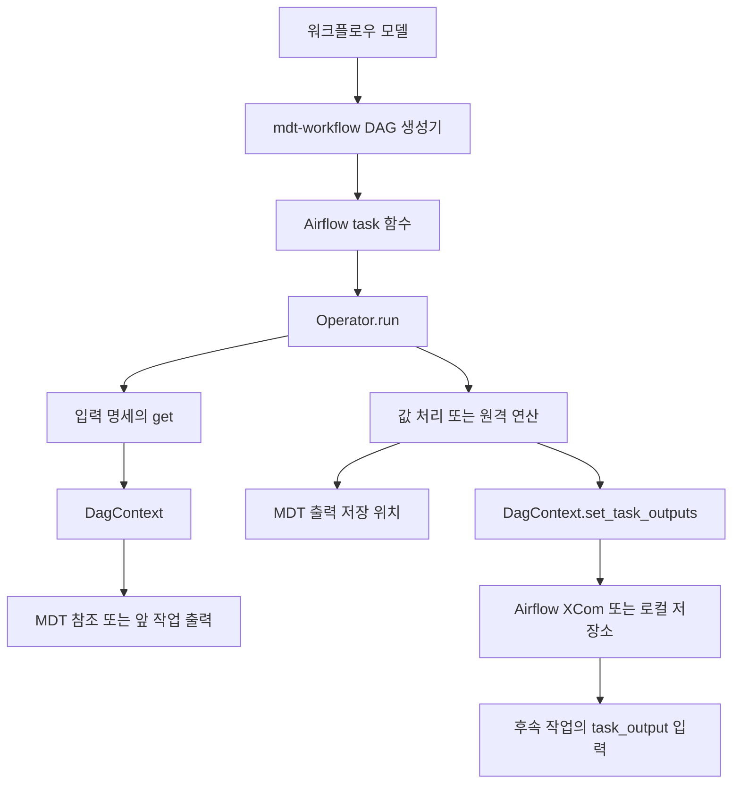

# mdtpy.airflow 워크플로우 인터페이스 가이드

`mdtpy.airflow`는 워크플로우의 각 작업에서 MDT 값과 연산을 사용하고, 작업 사이에 결과를 전달하는
Python 실행 인터페이스다. DAG 생성기, 작업 구현, 실행 환경 어댑터를 개발하는 사람이 사용할 수 있도록
호출 계약과 데이터 형식, Operator별 차이, 실패 처리를 설명한다.

기준은 2026년 10월 17일의 작업 트리다. 이 패키지는 워크플로우 모델 저장·실행 관리 REST API나
화면을 제공하지 않는다. 모델을 Python DAG로 변환하는 역할은 `mdt-workflow`, 스케줄링과 작업 상태 관리는
Airflow, 작업 본문의 실행과 MDT 입출력은 `mdtpy.airflow`가 맡는다.

## 1 전체 구조와 호출 흐름



세 인터페이스가 실행 계약을 나눈다.

| 인터페이스 | 책임 | 핵심 메서드 |
|---|---|---|
| `DagTaskArgument` | 입력값을 얻는 방법 기술 | `get(context) -> ArgumentValue` |
| `Operator` | 입력 해석, 작업 실행, 결과 저장·전달 | `run(context=None) -> None` |
| `DagContext` | MDT 접근과 작업 출력 저장·조회 | `get_task_output`, `set_task_outputs` 등 |

Operator는 Airflow의 `BaseOperator` 하위 클래스가 아니라 일반 Python 객체다.
Airflow의 `@task` 함수 **안에서** 객체를 만들고 `run()`을 호출한다.
`run()`은 결과 사전을 반환하지 않는다. 후속 작업은 `task_output()` 또는 컨텍스트의
`get_task_output()`으로 출력을 읽어야 한다.

`import mdtpy`만으로는 이 선택 모듈이 자동으로 import되지 않는다. 다음 공개 경로를 사용한다.

```python
from mdtpy.airflow import (
    AirflowDagContext, LocalDagContext, literal, reference, task_output, sink
)
from mdtpy.airflow.operator import SetElementOperator, PythonScriptOperator
```

## 2 데이터 타입 계약

| 타입 | 정의 | 사용 위치 |
|---|---|---|
| `ArgumentValue` | `ElementValue` 또는 `ElementReference` 또는 basyx `SubmodelElement` | 입력 명세를 해석한 값 |
| `TaskOutput` | `ElementValue` | 작업 간 전달하는 결과 값 |
| `inputs` | 입력 이름 → `DagTaskArgument` | Operator 생성자 |
| `outputs` | 출력 이름 → 저장 위치 `ElementReference` | Operator 생성자. 일부 Operator는 `None` 허용 |

입력에서 참조나 SubmodelElement를 받을 수 있어도, 이를 그대로 task 출력으로 내보낼 수 있는 것은 아니다.
두 기본 컨텍스트는 `set_task_outputs()`에 `ElementValue`가 아닌 값이 있으면 `TypeError`를 발생시킨다.

`ElementValue`는 타입을 보존하는 값 객체다. 표시·계산에 쓸 원시 값은 `.to_raw_object()`로 얻고,
작업 간 직렬화에는 `.to_json_node()`가 만드는 타입 포함 JSON을 사용한다.
일반 사전이나 배열을 무조건 `mdt_value()`로 감쌀 수는 없다.

### 고정 값의 변환

`literal(value)`는 `ElementValue`를 그대로 보관한다. 그 밖의 값은 `mdt_value()`로 변환하며,
현재 자동 변환 대상은 `str`, `bool`, `int`, `float`, `timedelta`다.
원시 `dict`, `list`, `None`, `datetime` 등은 이 경로에서 `ValueError`가 발생한다.
복합 값이나 특정 XSD 타입은 타입 포함 JSON에서 복원하거나 적절한 `ElementValue`를 직접 만든다.

```python
from mdtpy.airflow import literal
from mdtpy.value import parse_json_node

threshold = literal(10)
settings = literal(parse_json_node({
    "@type": "mdt:value:collection",
    "value": {
        "threshold": {"@type": "mdt:value:integer", "value": 10}
    }
}))
```

이 규칙은 Python·REST Operator가 원시 출력 값을 `ElementValue`로 바꿀 때도 적용된다.
복합 결과를 전달하려면 이미 타입을 갖춘 `ElementValue`여야 한다.

## 3 입력 명세와 저장 위치

### 입력을 얻는 세 가지 방법

| 팩토리 | 실행 시 동작 | 결과 |
|---|---|---|
| `literal(value)` | 생성 시 보관한 값 사용 | `ElementValue` |
| `reference(ref_string)` | 컨텍스트로 MDT 참조를 해석하고 읽음 | 일반 값, File 참조 또는 시계열 요소 |
| `task_output(task_id, argument)` | 앞 작업의 특정 출력 조회 | `ElementValue` |

`reference()`와 `task_output()`은 입력 명세를 만든다. 생성만으로 대상 값이나 작업 출력을 읽지 않는다.
`literal()`의 타입 변환은 생성 시 수행된다.

```python
from mdtpy.airflow import literal, reference, task_output, sink

inputs = {
    "temperature": reference("param:machine:Temperature"),
    "threshold": literal(10),
    "previous": task_output("prepare", "result")
}
outputs = {"result": sink("param:machine:Result")}
```

`sink(ref_string)`는 `mdtpy.reference(ref_string)`와 같은 실제 `ElementReference`를 만든다.
입력용 `mdtpy.airflow.reference()`는 `ElementReferenceArgument`이므로 출력 저장 위치로 쓰면 안 된다.
`operator/operator.py`의 `DagTaskOutputArgument = ElementReferenceArgument` 별칭은 실제 구체 Operator의
출력 생성자 계약과 다르다. 출력 값은 구체 생성자의 타입과 `sink()` 사용법을 기준으로 작성한다.

### File과 시계열 입력

`ElementReferenceArgument.get()`의 반환형은 대상에 따라 달라진다.

| 참조 대상 | 반환값 | 연동 시 의미 |
|---|---|---|
| 일반 MDT 요소 | `ref.read_value()` | 실행 시 읽은 `ElementValue` |
| File | `ElementReference` | 연산에 파일 참조를 전달할 수 있도록 참조 유지 |
| `timeseries:` 참조 | `ref.read()` | basyx `SubmodelElement` 자체 전달 |

File 판별을 위해 먼저 값을 읽고, File이면 그 값 대신 참조를 반환한다.
`SetElementOperator`는 이 참조를 다시 읽어 `FileValue`로 바꾼다. 따라서 이 경로의 File 값은 두 번 읽힐 수 있다.
File 값을 복사하는 것과 첨부파일의 실제 바이트를 전송하는 것은 다르며, SetElement 구현에는 첨부파일 복사 처리가 없다.

`SetElementOperator`는 시계열의 `SubmodelElement`를 `ElementValue`로 바꾸지 않는다.
시계열 요소를 그대로 작업 출력에 넣으면 출력 타입 검사에서 실패하므로, 시계열은 이를 처리할 연산의 입력으로
직접 넘기거나 Python 처리에서 필요한 값 형태로 변환한다.

### 데이터 참조와 실행 의존성

`task_output("prepare", "result")`는 값을 조회할 뿐 실행 순서를 등록하지 않는다.
Airflow DAG에는 `prepare_task >> consume_task` 같은 의존성을 별도로 설정해야 한다.
`mdt-workflow` 모델에서는 `inputArguments`의 `task-output`과 `dependencies`를 함께 작성한다.

MDT 참조는 작업이 실행될 때 읽는 현재 값이고, task 출력은 앞 작업이 남긴 결과다.
여러 실행이 같은 MDT 저장 위치를 공유하면 뒤의 실행이 값을 덮어쓸 수 있으므로, 동일 실행 내 결과 전달에는
task 출력 연결을 사용하고 외부에 보존할 결과에는 저장 위치를 지정하는 식으로 구분한다.

## 4 실행 컨텍스트

### DagContext 계약

사용자 정의 실행 환경은 다음 여섯 추상 멤버를 모두 구현해야 한다.

| 멤버 | 계약 |
|---|---|
| `task_id` 속성 | 현재 작업 ID 반환 |
| `mdt_manager` 속성 | 사용할 `MDTInstanceManager` 반환 |
| `get_submodel(instance, submodel_idshort)` | 대상 `SubmodelService` 조회 |
| `resolve_reference(ref_string)` | MDT `ElementReference` 반환 |
| `get_task_output(task_id, arg_id)` | 지정 작업의 `ElementValue` 출력 조회 |
| `set_task_outputs(outputs)` | 현재 작업의 이름별 출력 저장 |

`task_id`와 `mdt_manager`는 추상 property다. `__init__`에서 같은 이름의 인스턴스 변수만 설정하는 것으로는
추상 멤버 구현이 되지 않는다. 새 컨텍스트도 기본 구현처럼 출력 타입을 검사하고, 작업·인자 누락을
명확한 예외로 알려 주어야 한다.

`sink()`는 컨텍스트를 인자로 받지 않고 전역 MDT 참조 팩토리를 사용한다.
기본 컨텍스트의 `connect()`는 전역 MDT manager도 설정한다. 따라서 컨텍스트 객체만 나누면
한 프로세스에서 여러 MDT 서버에 대한 참조가 완전히 격리된다고 가정하지 않는다.

### 기본 구현 비교

| 항목 | `LocalDagContext` | `AirflowDagContext` |
|---|---|---|
| 생성자 | `(task_id, mdt_inst_url)` | `(mdt_manager_url=None)` |
| 작업 ID | 생성자 인자 | 현재 Airflow task instance |
| MDT URL | 필수 인자 | 명시한 URL 또는 Airflow Variable `mdt_manager_url` |
| 출력 저장소 | 프로세스 내 클래스 변수 | XCom의 `task_output` 키 |
| 저장 형식 | `ElementValue` 객체 매핑 | 타입 포함 JSON 매핑 |
| 참조 해석 | 지연 참조 생성 | manager를 조회하여 참조 해석 |
| 실행 순서 | 호출자가 직접 정함 | DAG 의존성과 Airflow 실행 환경 |

두 생성자는 `connect()`로 클라이언트를 만들지만, 이 호출 자체로 MDT 서버의 접근 가능성을 확인하지는 않는다.
`AirflowDagContext`는 생성 시 `airflow.sdk`를 import하므로 명시적인 URL을 넘겨도 Airflow 설치가 필요하다.
`run()`에 컨텍스트를 생략하면 이 컨텍스트를 생성한다. Airflow 밖에서는 `LocalDagContext` 등을 명시한다.

Local 출력 저장소는 컨텍스트 인스턴스 간에 공유되며 작업 ID만을 키로 사용한다.
DAG ID·실행 ID·사용자 단위 격리, 자동 초기화, 영속 저장 기능은 없다. 같은 ID의 출력을 다시 저장하면
기존 매핑을 대체한다. 독립 실행은 별도 프로세스로 분리하거나 테스트에서 저장소를 명시적으로 초기화한다.
Local 실행도 참조 읽기·출력 저장·원격 연산은 실제로 수행하므로 자동으로 dry run이 되는 것은 아니다.

## 5 Operator 호출과 출력 계약

모든 Operator는 `run(context=None) -> None`을 제공한다.
생성자에서 `inputs`와 `outputs`는 이름 기반 매핑이며, 아래 표의 고유 인자는 생성자에 직접 전달한다.

| Operator | 생성자 고유 인자 | 후속 작업에 전달하는 결과 |
|---|---|---|
| `SetElementOperator` | 없음 | 항상 `target` 하나 |
| `AASOperationOperator` | `instance`, `submodel`, `path` | 연산이 반환한 모든 결과 |
| `OperationSubmodelOperator` | `instance`, `submodel` | `invoke()`가 반환한 모든 결과 |
| `RestfulAsyncRpcOperator` | `base_url`, `op_endpoint` | RPC가 반환한 모든 결과 |
| `RestfulRpcOperator` | `op_url`, 선택 `timeout` | `outputs`에 선언한 결과만 |
| `PythonScriptOperator` | `script` | 본문이 `outputs` 사전에 넣은 모든 결과 |

### 값 읽기와 복사

`SetElementOperator`는 `inputs['source']`가 필수다. `outputs`가 비어 있지 않다면 `target`을 포함해야 하며,
이 두 조건은 생성자에서 검사한다. 실행 시 source 값을 읽고 target 저장 위치가 있으면 기록한 뒤,
저장 위치 유무와 관계없이 `{'target': value}`를 task 출력으로 남긴다.
그 밖의 이름을 추가해도 여러 값을 복사하는 Operator로 확장되지는 않는다.

### AAS 연산과 Operation 서브모델

두 Operator 모두 조회한 서비스가 `OperationSubmodelService`인지 검사한다.
`AASOperationOperator`도 임의의 일반 서브모델에 있는 Operation을 제한 없이 호출하는 구현은 아니다.

`AASOperationOperator`는 `path`로 연산을 찾고 반환 결과 중 `outputs`에 지정한 이름만 별도 저장한다.
저장 대상으로 선언했는데 결과에 없는 이름은 저장되지 않는다. 모든 반환 결과는 task 출력으로 전달된다.

`OperationSubmodelOperator`는 `{**해석한 입력, **outputs}`를 `invoke()`에 전달한다.
같은 이름이 양쪽에 있으면 출력 참조가 입력을 덮어쓰므로, 연산 계약에 맞춰 이름을 구성해야 한다.
내부 서비스는 생략한 입력을 등록된 기본 참조로 채우고, 별도 출력 참조가 없는 결과는 등록된 기본 출력 참조에
기록할 수 있다. 따라서 `outputs={}`를 “MDT 쓰기 없음”으로 해석하면 안 된다.

### 동기 REST 연산

`RestfulRpcOperator`는 전체 호출 URL인 `op_url`로 단일 POST를 보내고 결과를 기다린다.
입력은 RPC 규약에 맞게 직렬화된다. `timeout`은 Python에서 초 단위 숫자이며 기본값 `None`은 제한 없는 대기다.
임의의 REST 응답을 받아들이는 범용 HTTP 작업이 아니라 MDT RPC의 상태·출력 응답 형식을 요구한다.

`outputs`가 비어 있으면 원격 호출은 수행해도 전달 결과는 빈 사전이다.
선언한 출력이 응답에 없으면 `KeyError`를 발생시키며, 선언하지 않은 결과는 전달하지 않는다.
Python에서 직접 사용할 때는 다음처럼 저장 없이 전달할 출력을 선언할 수 있다.

```python
from mdtpy.airflow import literal
from mdtpy.airflow.operator import RestfulRpcOperator

predict = RestfulRpcOperator(
    op_url="http://example.invalid/predict",
    timeout=30.0,
    inputs={"value": literal(10)},
    outputs={"score": None}
)
```

이 코드는 설정 예이며 원격 호출은 `run()`에서 이루어진다. `None` 출력 저장 위치는 현재
`mdt-workflow`의 참조 전용 출력 모델로는 표현할 수 없다.

### 비동기 REST 연산

`RestfulAsyncRpcOperator`는 원격 연산 세션을 만들고 완료될 때까지 동기적으로 폴링한다.
이름의 “비동기”는 원격 RPC 프로토콜을 뜻하며, Python 코루틴이나 Airflow deferrable 작업을 뜻하지 않는다.

최종 URL은 `base_url + op_endpoint`로 조합된다. 기본 URL의 후행 `/`와 endpoint의 선행 `/`를 맞춘다.
시작 응답은 `RUNNING`과 `session_endpoint`를 제공해야 하고, 이후 세션 조회로 결과를 얻는다.
시작 응답에서 즉시 `COMPLETED`를 반환하는 서버는 현재 클라이언트의 시작 처리와 맞지 않는다.

Operator 생성자에는 폴링 주기·전체 대기 시간·개별 HTTP 제한 시간 설정이 없다.
현재 내부 클라이언트의 기본값은 폴링 3초, 전체 대기 제한 없음, 개별 HTTP 요청 30초다.
Operator의 `outputs`는 RPC 완료 후 로컬에서 기록하며, 내부 RPC 클라이언트의 출력 인자로 전달하지 않는다.
결과에 없는 저장 대상은 건너뛰고, 반환된 모든 결과를 task 출력으로 전달한다.

### Python 처리

`PythonScriptOperator`는 `inputs`와 비어 있는 `outputs` 사전을 같은 namespace에 넣어 `exec()`를 호출한다.
입력은 이미 해석된 `ArgumentValue`다. 출력은 기존 사전에 항목을 추가해야 한다.

```python
value = inputs['value'].to_raw_object()
outputs['result'] = value * 2
```

`result = ...`만 쓰면 task 출력이 생기지 않는다. `outputs = {...}`로 사전 변수를 재할당해도
Operator가 보관한 원래 사전이 채워지지 않으므로 `outputs['result'] = ...` 또는 `outputs.update(...)`를 사용한다.
File·시계열 입력은 `ElementValue`가 아닐 수 있어 모든 입력에 `.to_raw_object()`를 호출할 수는 없다.

본문에 넣은 모든 출력은 task 출력으로 전달되며, 생성자의 `outputs`는 그중 어떤 값을 MDT에 기록할지만 정한다.
본문이 만들지 않은 저장 대상은 건너뛰며, 생성자의 `None` 저장 위치는 아무 효과가 없다.
Python 생성자는 빈 본문을 거부하지 않지만 `mdt-workflow`의 `PythonScriptSpec`은 빈 본문을 거부한다.
본문은 worker의 Python 코드로 실행되며 별도 sandbox나 제한 시간 기능은 이 Operator에 없다.

## 6 작업 출력의 저장과 복원

Airflow 컨텍스트는 결과 사전의 각 값을 `ElementValue.to_json_node()`로 변환하여 다음처럼 저장한다.
아래는 `result` 출력이 정수 20일 때 XCom 키 `task_output`에 들어가는 값이다.

```json
{
  "result": {
    "@type": "mdt:value:integer",
    "value": 20
  }
}
```

조회는 `xcom_pull(task_ids=task_id, key='task_output')`로 사전을 얻고,
선택한 인자를 `parse_json_node()`로 복원한다. 따라서 직접 XCom을 기록하는 작업도 이 키와
이름별 타입 포함 JSON 구조를 맞춰야 `task_output()`으로 연결할 수 있다.
Airflow task 함수의 일반 반환값과는 별도의 저장 경로다.

출력은 각 Operator가 저장 처리를 마친 뒤 게시한다. 현재 인터페이스에는 중간 결과 스트림,
진행률 callback, 로그 조회, 실행 상태 조회 API가 없다. 이 정보는 Airflow 또는 상위 관리 서비스에서 다룬다.
출력 조회를 서비스로 노출하려면 호출자가 DAG·실행·작업 범위를 식별하고 권한을 확인하는 별도 API가 필요하다.
`DagContext.get_task_output()` 자체는 현재 실행 컨텍스트 안에서 사용하는 메서드다.

XCom payload는 JSON으로 변환할 수 있어야 한다. 파일 바이너리와 임의 Python 객체를 그대로 전달하지 않는다.
큰 결과를 전달할 때의 저장 용량·성능 한계는 연결한 XCom 환경에 따라 달라지며, 이 패키지가 크기 제한이나
외부 저장소 이동을 자동으로 처리하지는 않는다.

## 7 실패와 부수효과

### 예외가 발생하는 단계

| 단계 | 대표 오류 | 확인할 계약 |
|---|---|---|
| 입력 명세 생성 | `ValueError: unsupported property value type` | `literal()`에 전달한 원시 타입 |
| SetElement 생성 | `Input argument 'source' is required` | 입력 이름 `source`, 출력 이름 `target` |
| 컨텍스트 생성·조회 | Airflow import·Variable·현재 context 오류 | 실행 환경과 `mdt_manager_url` |
| 선행 출력 조회 | `KeyError: Task output ... is not found` | 선행 작업 실행, 의존성, 출력 이름 |
| MDT 대상 조회 | 연결 오류, 대상 없음, 인스턴스 상태 오류 | MDT URL, 참조, 대상 트윈 상태 |
| 연산 서비스 검사 | `ValueError: ... is not an operation submodel` | 선택한 서브모델 유형 |
| 원격 연산 | `OperationError`, `RpcExecutionError`, `RpcCancelledError` 등 | 연산 상태와 원격 원인 |
| 동기 RPC 결과 검사 | `KeyError: operation did not return output(s)` | 선언한 출력과 실제 응답 |
| Python 실행 | `SyntaxError`, `NameError`, 사용자 코드 예외 등 | script와 입력 타입 |
| 출력 변환 | `ValueError: unsupported property value type` | 반환한 원시 객체의 변환 가능 여부 |
| 출력 게시 | `TypeError: Unsupported TaskOutput type` 또는 직렬화 오류 | `ElementValue`와 JSON 직렬화 가능 여부 |

Operator는 이러한 오류를 공통 결과 객체로 감싸지 않고 호출자에게 전파한다.
Airflow 실행에서는 작업 실패로 이어질 수 있으며, 정확한 상태와 재시도 정책은 바깥 task 설정에 달려 있다.
Local 실행에서는 호출자가 예외를 처리한다.

### 저장과 출력 전달은 하나의 트랜잭션이 아니다

동기 REST·비동기 REST·Python Operator는 전달할 결과를 모두 `ElementValue`로 변환한 다음
저장 위치를 순서대로 갱신하고 task 출력을 게시한다. 이 때문에 **변환 실패** 시에는 이 저장 루프가 실행되지 않는다.
그러나 원격 연산이나 Python 본문이 이미 수행한 부수효과까지 취소되는 것은 아니다.

두 번째 저장 위치 갱신이 실패하면 첫 번째 갱신은 남을 수 있다.
저장은 성공했지만 XCom 게시가 실패하는 경우도 있다. AAS·Operation 서브모델·SetElement를 포함하여
전체 작업을 원자적으로 처리하거나 실패 시 저장을 되돌리는 기능은 없다.

재시도하면 원격 연산 호출과 MDT 쓰기가 반복될 수 있다. 재시도 정책을 정할 때 연산의 중복 실행 허용 여부와
출력 저장의 멱등성을 확인한다. 현재 Operator의 공개 인터페이스에는 공통 idempotency key 인자가 없다.

### 중단과 제한 시간

`Operator`는 `run()`만 정의하며 `stop()`, `cancel()`, `suspend()`, `resume()`은 제공하지 않는다.
내부 `RESTfulAsyncRpcClient`에는 `cancel()`이 있지만 Operator가 그 클라이언트를 외부에 노출하거나
Airflow 중단에 연결하지 않는다. 따라서 워크플로우 중단이 원격 연산 취소까지 보장하는 계약은 아니다.

동기 RPC의 요청 제한 시간과 Airflow task 제한 시간도 별개다. 비동기 클라이언트의 전체 제한 시간을
직접 사용하는 경우에도 시간 초과만으로 서버 세션이 취소되지는 않는다.
AAS 호출 계층은 현재 내부적으로 7일의 연산 timeout을 전달하며, 두 AAS 계열 Operator는 이를
생성자 옵션으로 노출하지 않는다. 모든 작업에 같은 timeout 인자를 전달하는 공통 어댑터를 만들 수는 없다.

## 8 mdt-workflow 생성기와의 연동

`mdt-workflow`는 JSON의 작업 유형과 옵션을 다음 Python 인터페이스로 변환한다.

| 모델의 `type` | 모델 옵션 | 생성하는 Operator와 인자 |
|---|---|---|
| `mdt.task.SetTask` | 고유 옵션 없음 | `SetElementOperator` |
| `mdt.task.AASOperationTask` | `operation` | `AASOperationOperator(instance, submodel, path)` |
| `mdt.task.OperationSubmodelTask` | `operationSubmodel` | `OperationSubmodelOperator(instance, submodel)` |
| `mdt.task.RESTfulAsyncRpcTask` | `baseUrl`, `endpoint` | `RestfulAsyncRpcOperator(base_url, op_endpoint)` |
| `mdt.task.RESTfulRpcTask` | `opUrl`, 선택 `timeout` | `RestfulRpcOperator(op_url, timeout=초 단위 숫자)` |
| `mdt.task.PythonScriptTask` | `script` | `PythonScriptOperator(script)` |

`operation`은 `<instance>:<submodel>:<path>`, `operationSubmodel`은 `<instance>:<submodel>` 형식이다.
모델의 `timeout`은 `30s` 같은 문자열이지만 Python 생성자의 값은 `30.0` 같은 숫자다.

| 모델 요소 | Python 표현 |
|---|---|
| `mdt:task_arg:literal` | `literal(mdtpy.value.parse_json_node(타입 포함 JSON))` |
| `mdt:task_arg:reference` | `reference(참조 문자열)` |
| `mdt:task_arg:task-output` | `task_output(taskId, argumentName)` |
| 참조형 `outputArguments` | `sink(참조 문자열)` |
| `dependencies` | Airflow task 간 `>>` 연결 |

식별자 문법·작업 ID 중복·필수 옵션 검사는 생성기 계층의 책임이다. Python 팩토리가 이를 동일하게 검사한다고
가정하지 않는다. 반대로 생성 성공만으로 참조 접근, 연산 응답, script 실행, 결과 저장이 검증되는 것도 아니다.

Python과 모델 인터페이스 사이에는 다음 차이가 있다.

- 동기 REST의 `outputs={'score': None}`은 Python 직접 사용에서 가능하지만 현재 모델에서는 불가능하다.
- Python script의 task 출력은 저장 위치 선언 없이도 모두 전달된다. 모델의 `outputArguments`를
  task 출력 전체 목록으로 해석하지 않는다.
- 비동기 RPC 클라이언트의 poll·timeout 옵션은 현재 Operator와 생성기에서 노출하지 않는다.
- Operator 이름, 생성자 키워드, 입력 헬퍼, 값 직렬화 형식은 이미 배포된 DAG도 사용하는 계약이다.
  이름 변경이나 출력 의미 변경은 생성기와 worker 배포판을 함께 고려해야 한다.

등록·실행 관리 API는
[mdt-workflow 인터페이스 가이드](../../../mdt/mdt-workflow/docs/workflow-user-interface-guide.md),
유형 추가 절차는 [새 Operator 추가 가이드](../../../mdt/mdt-workflow/docs/adding-operator.md)를 참고한다.
두 링크는 관련 저장소를 현재와 같은 디렉터리 구조로 배치했을 때 사용할 수 있다.

## 9 실행 예제

### 로컬에서 두 작업 연결

다음 예제는 고정 값과 Python 처리만 사용하므로 실제 MDT 서버나 Airflow 없이 실행할 수 있다.
독립 Python 프로세스에서 실행한다. URL은 클라이언트 생성에만 쓰며 이 예제에서는 네트워크 조회를 하지 않는다.

```python
from mdtpy.airflow import LocalDagContext, literal, task_output
from mdtpy.airflow.operator import SetElementOperator, PythonScriptOperator

manager_url = "http://example.invalid/instance-manager"

seed_context = LocalDagContext("seed", manager_url)
SetElementOperator(inputs={"source": literal(10)}).run(seed_context)

scale_context = LocalDagContext("scale", manager_url)
PythonScriptOperator(
    script="outputs['result'] = inputs['value'].to_raw_object() * 2",
    inputs={"value": task_output("seed", "target")}
).run(scale_context)

result = scale_context.get_task_output("scale", "result")
assert result.to_raw_object() == 20
print(result.to_json_node())
```

출력은 `{'@type': 'mdt:value:integer', 'value': 20}`이다.
`run()`의 반환값을 다음 작업에 넘기지 않고 컨텍스트에 게시된 이름별 결과를 읽는 흐름을 보여 준다.

### 같은 처리를 Airflow task로 구성

다음은 Airflow 환경에서 사용하는 DAG 예제다. worker에 `mdtpy`가 설치되어 있어야 하고,
`mdt_manager_url` Variable에 MDT Instance Manager URL을 설정해야 한다.

```python
from airflow.sdk import dag, task
from mdtpy.airflow import literal, task_output
from mdtpy.airflow.operator import SetElementOperator, PythonScriptOperator


@dag(dag_id="mdt_interface_demo", schedule=None, tags=["mdt"])
def workflow():
    @task(task_id="seed")
    def seed():
        SetElementOperator(inputs={"source": literal(10)}).run()

    @task(task_id="scale")
    def scale():
        PythonScriptOperator(
            script="outputs['result'] = inputs['value'].to_raw_object() * 2",
            inputs={"value": task_output("seed", "target")}
        ).run()

    seed() >> scale()


workflow()
```

정의한 task ID와 `task_output()`에 지정한 ID가 일치해야 한다.
결과는 `scale` task의 `task_output` XCom에 기록되며, MDT 저장 위치는 지정하지 않았다.

## 10 연동 검증과 현재 한계

연동 변경 시에는 다음 경계를 확인한다.

1. 모델에서 생성한 Operator 이름·키워드가 worker의 설치 버전과 일치한다.
2. literal의 타입이 JSON 직렬화·복원 후 유지된다.
3. `task_output()`의 작업 ID와 출력 이름이 실제 실행 의존성·결과와 일치한다.
4. File·시계열 입력이 연산에 필요한 참조 또는 요소 형태로 전달된다.
5. 동기 REST의 선언 출력과 Python의 전체 출력 전달 규칙을 구분한다.
6. 출력 변환 오류, 저장 오류, XCom 게시 오류를 각각 처리하고 재시도 부수효과를 확인한다.
7. Local 검증의 공유 상태가 다른 실행의 결과를 재사용하지 않도록 격리한다.

기존 자동 검증은 [tests/test_airflow.py](../tests/test_airflow.py)에 있다.
컨텍스트, 입력 타입, 출력 전달, JSON 왕복, 변환 실패 전 저장 방지 등을 mock 기반으로 검사한다.
실제 Airflow 스케줄러·worker나 MDT 서버를 사용하는 통합 검증과는 범위가 다르다.

```bash
uv run --env-file .env pytest tests/test_airflow.py
```

현재 패키지 재노출 구조 때문에 `mdtpy.airflow.operator` 속성이 패키지가 아니라
`operator/operator.py` 모듈을 가리킬 수 있다. 위 예제처럼 `from mdtpy.airflow.operator import ...`를
사용한다. 테스트에서는 하위 모듈을 직접 import한 뒤 `patch.object()`를 쓰면 이 경로 충돌을 피할 수 있다.

## 11 소스와 관련 문서

| 내용 | 소스 |
|---|---|
| 런타임 추상화와 XCom 변환 | [dag_context.py](../src/mdtpy/airflow/dag_context.py) |
| 입력 명세와 sink 팩토리 | [dag_task_argument.py](../src/mdtpy/airflow/dag_task_argument.py) |
| 입력·출력 값 타입 | [types.py](../src/mdtpy/airflow/types.py) |
| Operator 추상 계약 | [operator.py](../src/mdtpy/airflow/operator/operator.py) |
| 값 복사 | [set_element.py](../src/mdtpy/airflow/operator/set_element.py) |
| AAS 연산 | [aas_operation.py](../src/mdtpy/airflow/operator/aas_operation.py) |
| Operation 서브모델 | [operation_submodel.py](../src/mdtpy/airflow/operator/operation_submodel.py), [mdt_operation.py](../src/mdtpy/operation/mdt_operation.py) |
| 동기·비동기 REST 연산 | [restful_rpc.py](../src/mdtpy/airflow/operator/restful_rpc.py), [restful_async_rpc.py](../src/mdtpy/airflow/operator/restful_async_rpc.py) |
| Python 실행 | [python_script.py](../src/mdtpy/airflow/operator/python_script.py) |
| RPC 전송 규약과 시간 제한 | [RPC 클라이언트](../src/mdtpy/rpc/restful), [RPC 가이드](../src/mdtpy/rpc/README.md) |
| 값 생성·변환 | [element_value.py](../src/mdtpy/value/element_value.py), [factory.py](../src/mdtpy/value/factory.py) |
| 패키지 사용법 | [mdtpy.airflow README](../src/mdtpy/airflow/README.md) |
| Operator별 상세 예제 | [Operator README](../src/mdtpy/airflow/operator/README.md) |
| 전체 MDT API 사용법 | [프로그래밍 가이드](programming_guide.md) |
